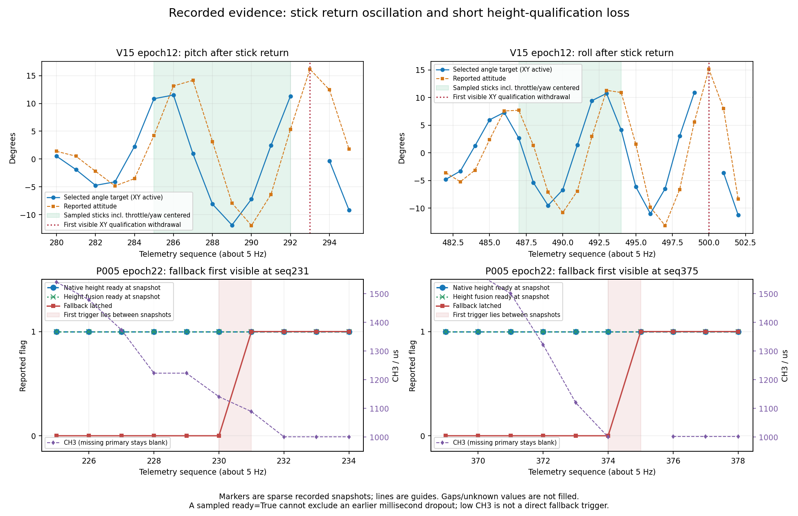

# 高度降级、旋转观测与回中响应：第二轮调查

本轮响应用户要求继续追查三个未关闭事项，重新读取原始有限窗口、当前B0B3和P2参考，并增加新的真实RTL见证。用户明确确认B0B3还未实飞，本轮只查之前的摆动、漂移与降级记录。没有修改已烧录固件、参数、原始数据、旧报告或约束；没有打开串口、执行HTTP机载事务、下载、Flash、电机或飞行动作。受控注入仅发生在离线仿真中。

这轮取得了新的排除与结构性结论，但没有证明三个飞行问题已经全部解决。尤其不能把“复现一种可行机制”写成“已知道历史那一刻就是这一机制”。

## 1. 关键新结论

| 问题 | 本轮新增证据 | 现在能说什么 |
|---|---|---|
| 回中像自稳、是否没有刹车 | 真实B0B3控制器加真实共享数学服务：P=.05/I=0、杆回中500ms、右向反馈500mm/s时仍输出约−2.49°反向roll；速度归零后目标回零，位置偏移不改变目标。49次输出在改变位置和POSITION_KP的两个实例中相同 | I=0仍有速度P纠正，不等于没有刹车；当前没有显式位置误差拉回环。此测试证明角目标行为，不是实际飞机刹停性能验收 |
| 旧V15回中后摆动 | 找到两段更干净的全杆回中窗：epoch12 seq285–292、487–494；目标持续正负往复，前段pitch约−11.87…+11.51°。真实杆滤波RTL在247ms衰到1%、371ms衰到0.1% | 一次回中输入的3Hz单调尾巴不足以单独解释持续往复。5Hz记录仍可能漏中间RC动作；不能单凭这些点认定唯一闭环首因 |
| 15°门槛是否是起振第一原因 | 上述回中往复先于seq293/500的首次可见倾角资格撤销；恢复时原生flow仍非零，导航却会门控为0并重新恢复 | 门槛与恢复状态可以造成后续断点，但不能作为这两段可见振荡的首次触发原因；不能把减小25°目标上限当已证根治 |
| 高度首个失效时刻 | 补入缺主帧seq375的其他同序号子包，第二次首次可见fallback从376前移至375，触发范围缩至FPGA uptime75000→75200ms | 下一快照height ready恢复为真不能排除中间短暂撤销。同期累计计数帮助排除一批已完整提交的输入失效；具体历史首因仍需首次事件锁存 |
| 旋转相关假速度 | 6118个不同下传原生包直接复算无字段/校验/乘法不一致；抽中flow均在20计数格点；原生100Hz中仅约4–5%进入现有记录 | 格点来自已保存的原始字节，不是UI舍入；它不是厂家固定分辨率。不能据低速flow=0判断内部补偿有效，融合小数也不增加原生信息 |
| 旋转补偿系数能否从旧曲线拟合 | h×gyro与gyro高度共线，动态两轴特征相关约.99677/.98697；联合拟合会翻转高度项符号；接收配对正确但曝光相位未知 | 无法唯一分离旋转流、转轴偏置与真实平移，不能把旧曲线回归系数上板。零整帧lag较强不等于曝光0ms延迟 |

## 2. 高度链的可证排除和边界

[高度支线](height/HEIGHT_FINDINGS.md)逐项检查了当前B3与历史P005的实际链路。8个高度/传感器关键文件逐字节相同，参数接口任务没有改写这些算法。正常pose/MTF回调不会因“进入busy”而必然撤销acc、geometry或fusion ready。

两次边界的MTF integration_breaks保持1，sample_count每次约+20，missing/duplicates/restarts/UART/CRC/timeouts无增量。按实际metric状态机，这可排除会增加该累计量的已完整提交ToF状态无效、低距离、超过12000mm、flow无效、quality零和模块序号中断等机制；不覆盖未采到的其他资格条件，也不能把完整提交计数当作所有中间内部状态的记录。

进一步使用geometry成功发布计数，两个边界的navigation_sequence也各+20，MTF sample_count减发布计数维持270。seq227/232/374/375等锚点的age为1或9ms，超过正常geometry计算最长200µs的待发布相位。在同步RTL与同组快照契约下，孤立一份5000<distance_mm<=12000帧会少一次geometry发布、留下计数差变化，因此**虽能在仿真复现类似外观，也不符合历史中作为唯一首因的累计发布计数**。

应优先抓取acc资格/±3g数值门及100ms freshness/交付时序的短暂撤销，再区分其他复合状态机制。完整模块计数连续不排除一次先停顿后补发的交付：reader link门限200ms，而控制fresh门限100ms。孤立sticky math/queue故障在输入始终健康且没有reset时不会自己恢复，也不能单独解释下一快照ready恢复；若同时发生输入无效/重置，仍有混杂。以上是条件排除，不是任意硬件毛刺或复合故障的形式证明。

两段降级前CH3都已下降，但taking_off仍真，正常落地锁定尚未完成。CH3低本身不在fallback enter条件内；这不排除降落动力或接触冲击间接改变加速度/观测。

新增高度子链真实RTL构造测试使用当前nav、四客户端共享数学服务、metric、pose adapter及fallback，每例50MHz运行4000000拍（80ms），编译/运行均实际exit0。夹具假定core健康且已armed/taking_off，source_age固定0；不覆盖arming/PWM、UART线字节、交付停顿、飞行器动力学或历史输入高频重放：

| 用例 | 注入 | 真实RTL结果 |
|---|---|---|
| 正常对照 | 正常1ms pose、10ms MTF；后40ms把CH3降到1000 | 首次ready后零次资格掉落，fallback不锁存，Zreason0 |
| 加速度资格 | 只一份1ms pose tuple的az=30001mm/s² | 50.00064ms掉高度资格、62.04774ms恢复；fallback仍锁存、Zreason2 |
| 测距范围 | 单份MTF distance=5001mm，状态1，仍在reader许可的12000mm内 | 51ms掉资格、72.05666ms恢复；fallback同样锁存、Zreason2 |

三例pose adapter的valid都未掉，metric integration_breaks都保持1。两类短暂输入均可产生“后来的ready已恢复、降级却保持”的模式；这不证明实际曾发生az=30001或distance=5001，场景2作为历史唯一解释还受到上述geometry发布计数反证。权威运行回执为[rtl_attempt_03/rtl_results.json](height/rtl_attempt_03/rtl_results.json)；早期TMP/include编译环境失败记录原样保留，不算产品RTL故障。进一步输入、输出和适用边界见高度报告。

## 3. 回中与悬停能验收到哪一步

[响应支线](response/RESPONSE_FINDINGS.md)补查了原V15 epoch10长中杆活动段。其中seq635–679全杆居中8.8296秒、目标高度698mm、融合高度671–725mm，姿态RMS跟踪误差约0.507/0.463°。这支持该段内部估计和姿态跟踪的描述，缺少外部位置真值，不能认证绝对悬停精度。

当前P005的1505个主帧中只有46个可见合格XY活动帧，仍没有合格“打杆→回中→持续保持XY”窗口。P2纯OF分支也以速度P/I/FF为主，明确的位置误差到速度目标出现在其GPS分支；不能把该分支的位置环要求无条件套到本机OF链。

要区分“减速到零”和“回到原地”，必须分别定义指标。I=0去掉累计速度误差/偏置补偿，不会删除P速度反馈；带I时的状态与位移关系也受yaw、限幅、失效/重置和目标速度积分约束，不能等同固定世界位置锁定。本轮没有据稀疏日志给出唯一P/I推荐值。

## 4. 旋转链的确定限制

[旋转支线](rotation/FINDINGS.md)包含原始包独立解码、时钟与接收配对审计、格点/覆盖率、两轴滞后与共线性检验。所查接收tuple没有简单配错包，但包到达年龄不包含未知曝光和内部滤波延迟。模块0x51记录没有固件版本、内部补偿或曝光起止字段；不能借协议名、保留字或质量非零作补偿证明。

当前FPGA没有在这条MTF flow链中再做一次显式gyro扣除；是否需要补偿、模块是否已补偿仍需实际版本契约与受控运动共同判断。P2的光学校正常数不能直接复制到MTF。所查单位/字段正确不代表光流物理速度正确，更不代表全部估计和控制算术已无问题。

## 5. 下一步应补什么，而不是继续盲目调参

1. **高度优先锁存首次撤销原因。** 在armed/taking_off及已有有效高度条件下，捕捉第一次core_vertical_available下降与fallback入口，保存前后资格掩码、原生距离/状态/年龄/epoch、acc/姿态资格、融合ready/fault与FPGA时间/序号。需要记录瞬间首因，泛化reason2或再看下一张5Hz快照不够。具体信号和最小方案见高度报告。本轮只提出可审阅诊断范围，没有偷偷改当前Flash。
2. **旋转只需受控地面采集。** 拆桨、固定纹理和光照、固定光心/已知转轴偏置，分高度和单轴正反转动；保留完整原生100Hz与同一时钟的接收/gyro/姿态记录，另核对实际模块版本与补偿契约。不需要为识别该问题继续带桨试错，也不能用现有5Hz快照假充100Hz。
3. **回中/悬停最后分别验收。** 先确认观测可信和未进入降级，再评估减速时间、回中后的速度/位置误差。闭环性能需要受控真实运动和外部真值；本轮离线实验不能代替。没有新增硬件或飞行授权请求。

本轮未定位到足以凭现有数据直接修改已烧录B3控制算法的唯一缺陷。因此没有删保护、套P2补偿系数或擅自更改增益；这不是“已排除代码问题”，而是把可证明的实现行为、已知差异与尚不可识别的历史首因分开记录。

## 6. 复算、来源与保存

- `input_ledger.json`绑定8个旧有限原始源及55份当前B3源码；原始源SHA与旧summary全部一致。第三方P2源码仅作本地外部输入，不再分发。
- `current_session_summary.json`固定检查最新地面日志前92608918字节，末记录为北京时间2026-10-26 09:00:37。该前缀epoch0–7没有armed/controller_enabled/taking_off活动；它不提供B3实飞证据，也不代表其后没有发生未记录的飞行。
- `response/`与`height/`保存实际RTL测试源、真实编译/运行回执及派生轨迹。P2部分仍是源审查和方程模型，未编译执行整套P2 C；不冒充完整C对RTL一致性证明。
- 各支线产物清单与本目录总清单分别绑定SHA。原始无线/完整飞行日志、第三方源、vendor simlib和编译VVP不上传。脚本读取原本地外部路径，导出代码库本身不含这些原始输入，缺少时应明确报错。

在仓库根目录运行 `python -B analysis/20261026_flight_followup/verify_followup.py` 可验交付字节与冻结B3源码；加 `--external-inputs` 还会核对本机H中的8份原始有限窗口。验哈希不是重新运行仿真或飞行。

图中点为已记录快照，连线仅辅助阅读，缺帧不补。V15图的绿色区域是采到的全杆居中区，红线是后续首次可见倾角资格撤销；P005图显示fallback在两次快照间锁存，而采样时高度ready仍为真。图不能还原帧间隐藏动作或毫秒级首因。
