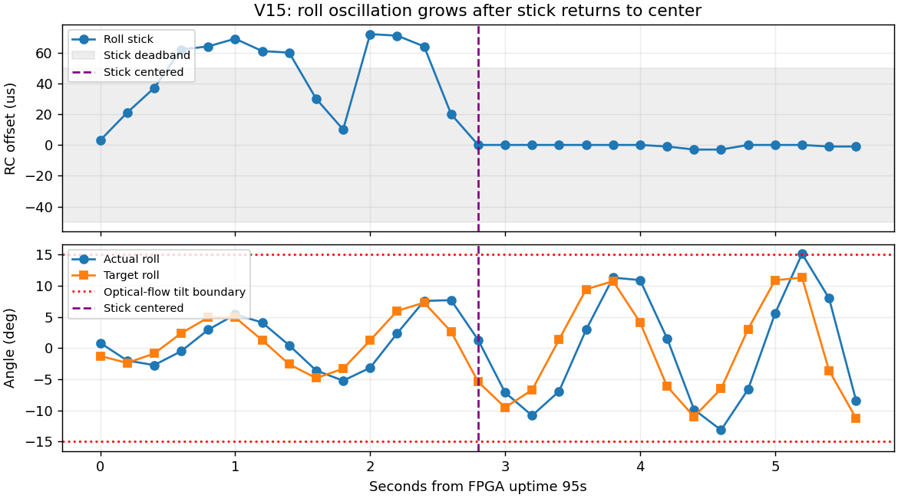

# V15 光流打杆振荡调查（2026-10-25）

**结论：本轮光流模式的动态打杆/回中测试不通过。证据最强的机制是未去旋转的光流速度进入速度 PI，打杆激起机体转动后，错误速度反馈与外环延迟形成自激；超过 15° 后 XY 退出/恢复，进一步打断速度估计。** 旋转污染是目前的首要根因假设，尚不能仅凭飞行相关性将其认定为唯一原因；速度环与姿态内环的动态匹配仍需验证。

操作者明确反馈：光流模式下前后左右打杆不稳定、来回振荡；补充确认“打杆和回中后都会振荡”。此前中杆悬停成功的历史记录保留，但不能作为动态打杆稳定性通过的依据。

## 实测证据

视频长约 121.62 秒，可见两次离地尝试。只读地面接收日志中最近一次上电 epoch 12 有两段起飞控制记录：北京时间 21:47:39.764–21:47:56.888、21:48:17.015–21:48:36.162。视频无同步时钟/遥测叠加，本调查不声称逐帧精确对时。

| 项目 | 前后打杆一段 | 左右打杆一段 |
|---|---:|---:|
| 油门起飞状态的接收帧 | 84 | 95 |
| 主要摇杆输入 | CH2 1500–1642 μs | CH1 1497–1572 μs |
| 主要姿态范围 | 俯仰 −11.95°…+16.15° | 横滚 −13.62°…+15.13° |
| 对应目标角范围 | −11.87°…+11.51° | −11.24°…+11.32° |
| 回中后仍来回摆动 | 是 | 是 |
| 越过 15° 且 XY 不再就绪/启用 | FPGA 58.8 s | FPGA 100.2 s |
| 该帧垂直控制 | 保持启用 | 保持启用 |

两段共 179 个接收帧中：SWC/CH7 始终为 2000 μs；IMU 拒收、控制故障、MTF 校验错误、UART 错误均为 0。光流数据年龄 1–11 ms。两次越界时模块原生 flow_valid 仍为真，XY 原因码为 4，符合本地姿态门限退出，而不是模块串口失联。接收记录中有 17 帧电机命令达到 2000 μs，可能进一步压缩控制余量；这不是两次起振的唯一解释。

关键例子：

- FPGA 57.2 s，CH2 已回到 1501 μs，但俯仰目标 +10.84°，俯仰角速度约 +53.60°/s，光流前向观察值 +2349.6 mm/s；随后目标反向至 −11.87°，实际姿态继续往复。
- FPGA 97.8 s 后 CH1 回到约 1500 μs，横滚摆幅仍逐步扩大。FPGA 100.0 s，横滚角速度 +64.96°/s、光流右向观察值 −3029.6 mm/s；FPGA 100.2 s 横滚达到 +15.13°并失去 XY 就绪，100.4 s 又恢复。
- 在两段高度超过 0.6 m、XY 启用的诊断窗口中，光流速度与 `高度 × 对应角速度` 的相关系数分别约 0.930、0.922。该关系强烈支持旋转分量污染，但真实平移、光流尺度和采样/曝光延迟仍然混杂；拟合值不能直接用作补偿系数。

## 代码机制与根因排序

1. **未去旋转的速度反馈：首要嫌疑。** 已冻结 V15 的 `sensor/mtf01p_reader.v:120` 将模块归一化光流与距离相乘；`sensor/mtf_shared_geometry.v:189` 做轴交换/符号变换，203–235 行转换、旋转至局部世界坐标。该模块没有陀螺仪角速度输入，66 行明确输出 `rotation_compensated=0`。随后 `position/mtf_shared_flow_fusion.v` 将这一观察值用于速度融合，`position/mtf_xyz_hold_control.v:335`–354 将速度误差、积分与前馈转成姿态目标。打杆造成倾斜转动时，旋转造成的图像运动会进入这条速度反馈链，解释了回中后目标角继续反向、摆动继续增长的机制。光流测量包含图像角运动，纯转动需要与相应陀螺量核对，参见 [PX4 官方光流说明](https://docs.px4.io/main/en/sensor/optical_flow#scale-factor)。
2. **15° 出入边界：已观察到的次生放大机制。** `mtf_xyz_navigation_control.v:80` 将光流倾角门限设为 1500 cdeg。`sensor/mtf_shared_geometry.v:45`–52 对任一轴越界立即撤销光流就绪；速度融合失去条件后清状态，而已经完成的控制器积分/滤波状态可在恢复后保留。前期与原始 V15 源码一致的真实 RTL 回归已证明这一退出、保留、恢复行为。本轮日志在 16.15°/15.13° 两个点观察到对应退出，约下一个接收周期恢复。
3. **速度环增益、过滤延迟与姿态内环匹配：尚待区分。** 回中后目标角本身在往复变化，说明外环提供了振荡指令；不能只据此排除姿态内环的阻尼/延迟问题。约 5 Hz 的地面接收帧不足以完整验收更高频的内环动态。

此次起振和增长窗口的目标角均未达到 12°；因此仅将 25° 上限改为 12°，不会改变这些起振阶段的目标。姿态静态零点也不能替代旋转补偿和动态环路验证。不能将前期两个可选改动当成本轮问题的完整修复。

## 下一步

先离线验证轴向、光流尺度和与模块采样窗口匹配的陀螺去旋转，复现本轮“短时打杆→回中”的输入；在去掉旋转伪速度后再检查速度 PI、积分恢复与角度边界的动态行为。不可从此处飞行相关性直接拟合一个补偿常数后上板。

本次调查没有修改固件、没有下载镜像、没有开始综合或布线。V16/V17 继续暂停。当前 V15 保留用于问题复现，光流动态稳定性状态为“不通过/待修复”，此前悬停成功仅保留其原有范围。

## 证据与限制

- [视频抽帧](video_contact_sheet.jpg)、[归档原始视频](operator_stick_flight.mp4)
- [对齐后的遥测 CSV](aligned_telemetry.csv)、[两次控制段统计](log_summary.json)
- [角速度相关性与范围](characterization.json)、[完整信号图](oscillation_evidence.png)
- [截取日志元数据](capture.json)、[只读截取的原始解码日志](recent_telemetry.jsonl)
- 约 5 Hz 的地面接收数据存在缺帧；按 epoch 和 frame sequence 配对，缺少配套帧的字段保留为空。传感器曝光与收到时刻的角速度并未完成同步资格验证。
- 证据支持上面的根因排序，尚无固定旋转中心、无真实平移的独立动态实验来将旋转分量与平移分量完全分离。
