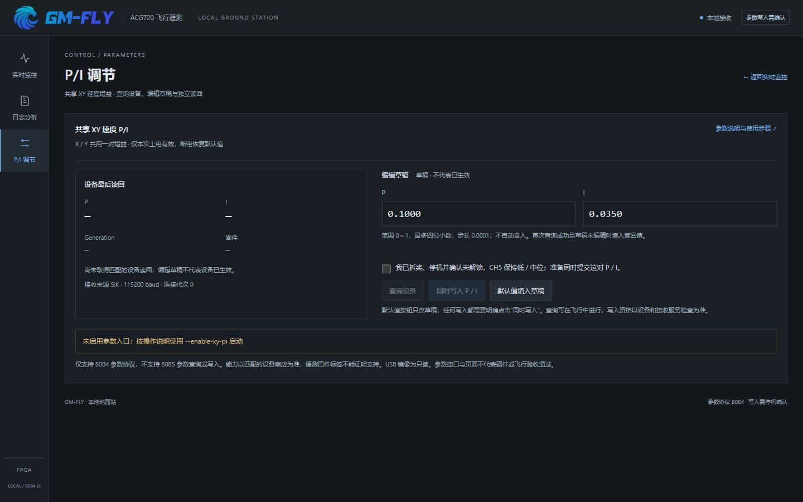
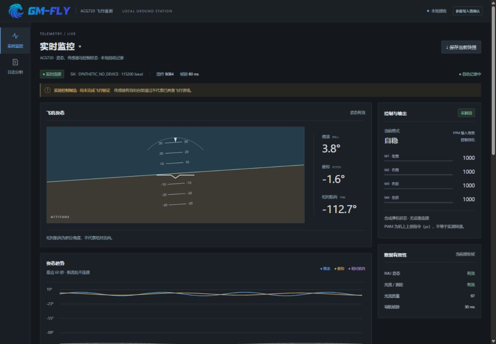
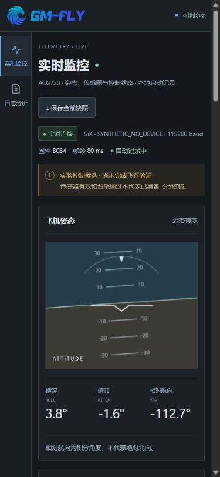
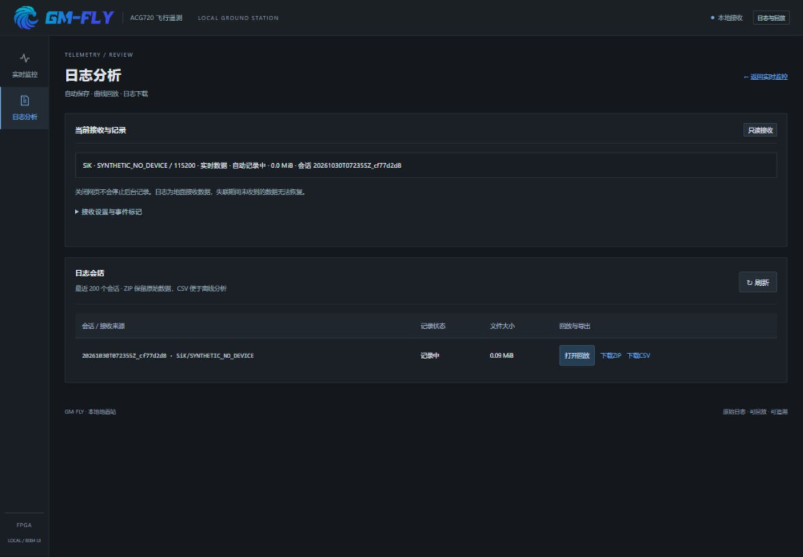

# GM-FLY 本地地面站界面改版 · 2026-10-30

> 2026-10-31更新：本文件下方为10月30日界面改版的历史记录。此后已加入显式B0B5参数协议选择，使用独立冻结codec，默认B0B4仍拒绝B0B5。当前能力及启动方法以 [README](README.md) 和 [远程参数接入说明](../../web/flight-console/REMOTE_PI_20261031.md) 为准。新增接入已通过88项Python原生回归与Node界面合约；尚未连接实体设备验收。历史“B0B5不支持”的描述仅适用于10月30日版本。

## 范围与实际依据

本机 HTTPS 请求访问 https://gmflylog.com/ 和 `/styles.css` 成功，首页返回 HTTP 200；网页抓取工具未能直接访问该站。视觉依据为实际取得的官网 HTML/CSS、仓库 `web/flight-console/frontend/index.html` / `styles.css`、其 GM-FLY 品牌 SVG，以及 `web/gmflylog-live-verified.png` 历史截图。使用深炭色背景、蓝色强调、GM-FLY 顶栏、侧边导航和细边框面板，未复制官网 `app.js`。

只读检查未发现 8765/8766/8767/8874 监听或明确匹配 B0Bx 地面站的 Python 进程，无法证明用户当前运行哪个实例；旧文档中的“当前只读接收端”不作为运行证据。本次以具备 P/I 功能的 `ground/B0B4` 为主要对象；`ground/B0B0` 为只读接收页，未提供 XY P/I。B0B0、B0B3 和 ground 根目录版本保留原样。当前用户固件是 B0B5，本次没有修改或验证其固件。

## P/I 独立页面调整

按用户后续要求，原 P/I 卡片完整移至 `/parameters`，左侧第三项为“P/I 调节”。实时页不再包含参数卡片或加载参数脚本，日志页和参数页也保留三项导航及正确活动状态。帮助页返回参数页。参数 JS、API、协议和安全保护未修改。

调整后再次原生运行 80 项 Python 测试和 Node 参数合约测试，全部通过。桌面 1440px 与手机 390px 独立页检查无横向溢出；无串口模式下查询/写入保持禁用。8874 无串口预览已更新并保持运行。



[手机独立参数页截图](ui-verification/parameters-mobile.jpg)。下方初版截图保留为视觉改版记录，参数入口以本节为准。

## 实现

- 实时页采用桌面姿态/趋势主区及控制输出/健康侧栏。手机重排为单列；320px 下相对航向独占一行，避免负角度挤压。导航、传感器、遥控通道、记录器与高级诊断仍完整保留。
- 日志页统一外观，手机日志表改为纵向卡片，回放、CSV/ZIP 下载直接可见；空列表有明确提示。接收设置、事件标记、区间分析、播放和分析 JSON 导出保留。
- 本地继续请求 `/api/state` 及原有日志/参数接口，未引入 `/api/live`。保留原有 DOM ID；绘图仅调整配色，不变更有效性判断、断流处理或趋势算法。
- 品牌 SVG 随本地目录提供，并在静态 allowlist 中注册 `image/svg+xml`，保留 `nosniff`。无外网字体、脚本或其他运行依赖；未启用分享。
- P/I 原有查询、停机确认、单次成对 SET、ACK 后独立 GET、未知结果先查询及不自动重发保护均保留。前后端仍严格识别 `0000B0B4`，新增 B0B5 拒绝测试；界面和帮助明确标出不支持 B0B5 参数查询或写入。

## 离线验证

```powershell
python -X utf8 -B ground/B0B4/run_ui_regression.py
node ground/B0B4/test_xy_pi_ui.cjs
node --check ground/B0B4/dashboard.js
node --check ground/B0B4/logs.js
git -c core.whitespace=cr-at-eol diff --check
```

Python 原生全量 **80/80 通过**：77 项既有测试、3 项新增资产/预览测试。使用仓库原有 fixtures，没有替换、适配或补值。运行器只将既有测试输出和临时日志重定向到独立临时目录，退出清理，并防止未模拟的真实串口/设备枚举。Node 的实际 HTML/JS 合约测试及语法检查通过。结果见 [regression.json](ui-verification/regression.json)。

浏览器使用独立临时回环端口 **2214**，真实 `Host(no_serial=True)` 与本地 HTTP 路由。仅合成 32 个新主帧进入临时记录器；未读取或修改用户原始运行日志。预览拒绝所有 POST，禁止真实串口创建和设备枚举。

| 检查 | 结果 |
| --- | --- |
| 默认无数据 | 姿态、输出、导航显示未知/破折号；参数查询/写入禁用 |
| 合成实时数据 | 姿态、趋势、健康、PWM/通道、日志状态正常显示 |
| 过期 / 断连 | 有文字状态提示，读数清空并降亮度；不继续显示有效 PWM |
| 合成 B0B5 | 固件标签显示 B0B5；参数查询/写入禁用，不伪造能力 |
| 参数已读回 | 未勾选停机确认时写入禁用；勾选后仅在合成资格满足时可用 |
| 参数忙碌 / 结果未知 | 忙碌时控件禁用；未知时仅允许查询，写入禁用 |
| 日志 | 空态、真实合成日志分析、字段选择、播放到末尾、分析 JSON 浏览器下载、CSV/ZIP HTTP 导出通过 |
| 响应式 | 1440、1024、768、390、320px 均无页面横向溢出；手机日志操作保留 |

浏览器无警告/错误。状态摘录见 [states.json](ui-verification/states.json)，中等窗口结果见 [responsive.json](ui-verification/responsive.json)。P/I 单次提交、读回和异常恢复的行为证据来自既有 Node/Python 测试；浏览器预览没有实际提交任何参数命令。

## 启动入口

在仓库根目录运行；以下是无串口、真实无数据入口（日志使用临时位置）：

```powershell
python -B ground/B0B4/launch.py --no-serial --http-port 8874 --logs "$env:TEMP/gmfly-local-preview"
```

然后打开 http://127.0.0.1:8874/ ，日志页为 `/logs`。若端口被占用，自行选择空闲端口；本次未启动/停止或替换用户既有服务。

合成预览使用独立脚本，不改变正常启动逻辑，正常退出时清理合成日志：

```powershell
python -B ground/B0B4/preview_ui.py --http-port 0
```

使用脚本输出的实际 URL。默认无数据；`/__preview?scenario=live` 为实时样例。支持 `empty`、`stale`、`disconnected`、`b0b5`、`pi-ready`、`pi-busy`、`pi-unknown`、`logs-empty`，加 `&view=logs` 打开日志页，`&view=parameters` 打开参数页。页面中的合成资格仅供 UI 检查，所有 POST 均拒绝。

本次 2214 临时服务已关闭，浏览器临时尺寸覆盖已恢复。关闭进程后遗留的合成目录 `C:/Users/ScherrerL/AppData/Local/Temp/gmfly-ui-preview-arqv075d` 仍保留；自动审批以策略限制为由拒绝删除该目录。目录只含本次合成会话 `20261030T072355Z_cf77d2d8`，不是用户原始运行日志。

需要实际接收时，另行核对真实电台串口及唯一接收器所有权，使用现有 `launch.py --port COM实际串口 --source SiK --baud 115200` 入口。B0B5 保持只读，不加 `--enable-xy-pi`；本次没有连接任何设备。

## 仍需实机确认

实际串口、B0B5 的真实遥测字段覆盖/健康显示、链路失联与恢复、持续记录及手机实机触控仍需用户后续确认。本次离线 UI 验证不构成参数协议扩展或硬件/飞行验收；B0B5 参数能力需要另行有协议证据的实现，不能通过本次改版取得。

## 预览（全部为合成数据）







更多截图：[手机日志](ui-verification/mobile-logs.jpg)、[手机参数](ui-verification/mobile-parameters.jpg)、[手机日志分析](ui-verification/mobile-log-analysis.jpg)。
