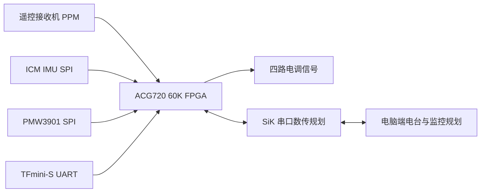

# 00b：初始接线与接口规划

时间范围：2026-10-01～04，北京时间；于2026-10-22根据旧会话整理。这里的“接线”指模块连线与GPIO规划，FPGA综合/布局布线证据另见后续源码阶段。**本页不提供旧针脚表作为当前照接方案。**

## 当时的功能链路



箭头表示规划的接口方向，不代表当时已完成全系统控制或通信验收；后续实际SiK固件采用单向下传。

- **10-01 12:41:16**：参考厂家资料，将低速SPI/UART/PWM信号集中到P7；这是本项目分配的GPIO功能，FPGA没有固定在这些针脚上的SPI/UART外设。
- **10-01 13:14:56**：用户提供实物IMU针名及独立稳压模块，修正此前混用了另一种IMU板针名/供电的建议。
- **10-02 22:27:54**：实物接收机确认是FS-iA6B。
- **10-03 18:52～19:01**：从最初讨论的i-BUS转为用户选择的PPM；19:00:28用户报告对码完成。PPM仅改变接收机→FPGA输入，四个ESC仍由FPGA控制。
- **10-03 21:46:02**：明确PMW3901本体的七线接法，与板载VL53L0X可选I²C两线分开；已有独立TFmini-S，初版不必启用该可选测距。
- **10-04 01:44:31**：用户报告线已焊完。这是用户进展报告，不等于逐线电气校验完成。

## 当时的电源拓扑

```text
电池 / 分电
  ├─ 电调动力输入 → 四个电机
  ├─ 控制板12V稳压支路 → ACG720电源输入
  ├─ 5V外设支路 → 按实际模块规格供电
  └─ 3.3V外设支路 → 按实际模块规格供电
所有信号接口共地；电源电压与FPGA IO电平分别核对。
```

这是初始拓扑摘要，不为未知模块、电池或稳压器提供额定能力结论。后续核实12V模块是升降压型；此前称为纯降压并不准确。

## 必须保留的后续纠正

本地《ACG720_60K_无人机接线表.md》标题为“2026-10-10核对版”，之后仍有修订，不是10月1日冻结初稿，因此本阶段只保存摘要与原文哈希，不将整份后改文档冒充初始方案。

原ICM小板后来有电气/读取异常，后续改BMI088；ATK-PMW3901和独立TFmini-S后来改为MTF-01P；SiK发送脚也曾纠正。动力型号直到后续实物核对才确认AIR 20A V2.0，电机位置与旋向到10月11日拆桨逐只测试才确认，不能提前写成初始接线已验收。

当前球位、传感器、数据单位与数传方向以[当前硬件文档](../../docs/HARDWARE.md)和选用工程CST为准。这里不保留易被误用的旧P7物理针号/旧IMU供电表。来源见[证据索引](evidence_sources.json)，不包含原始聊天、照片或私人设备标识。
